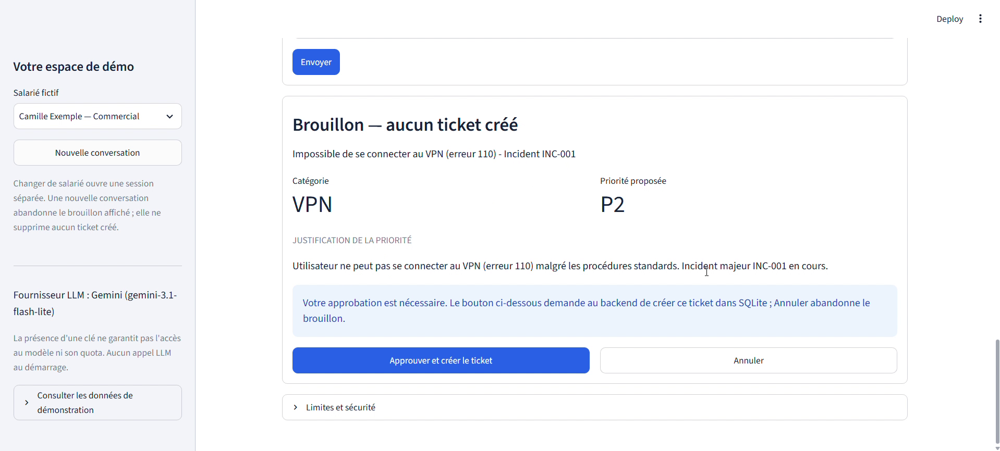
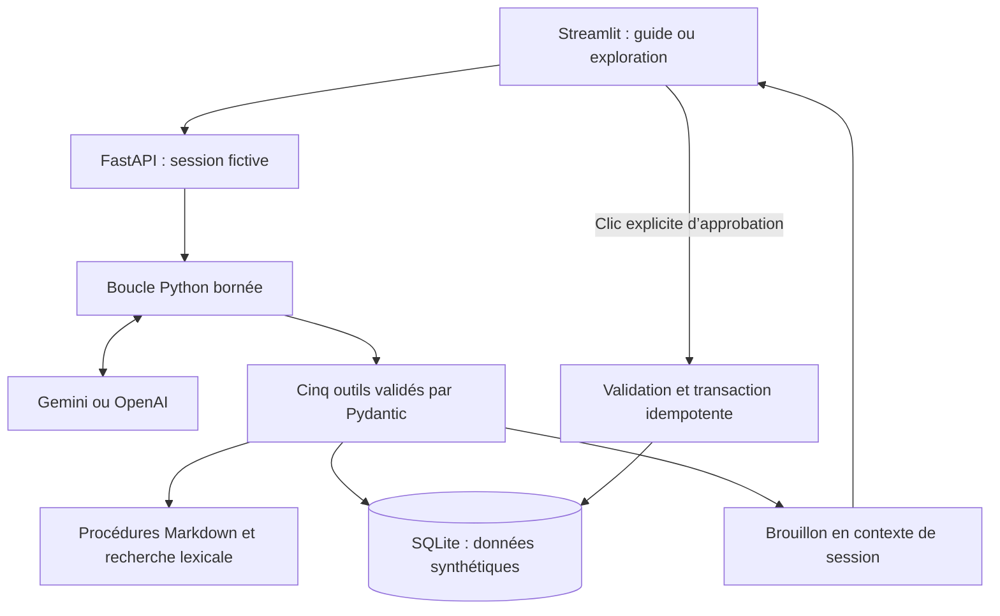

# OpsDesk AI — Agent de support informatique

**Du signalement IT au ticket approuvé : un agent qui choisit ses outils, cite ses sources et laisse la décision d’écriture à l’humain.**

Dans une PME, le support doit croiser procédures, incidents et inventaire avant de répondre. OpsDesk AI illustre ce travail sur des données fictives : l’agent consulte les informations utiles, demande une précision si nécessaire et prépare un ticket à valider.

Python · FastAPI · Streamlit · SQLite · Gemini / OpenAI · pytest

**[▶ Voir la démonstration vidéo — 1 min 13,6 s](https://github.com/Adjaroud/opsdesk-ai/blob/main/docs/media/opsdesk-ai-demo.mp4)** · [Télécharger le MP4](https://github.com/Adjaroud/opsdesk-ai/raw/refs/heads/main/docs/media/opsdesk-ai-demo.mp4)



*Capture extraite de l’enregistrement réel. La vidéo montre aussi les sources, les appels d’outils, la confirmation de création et Mes tickets. Les attentes raccourcies et les prises complémentaires sont signalées ; ce n’est pas une mesure de latence.*

## Essayer le projet

- **Démo guidée** : suivre le scénario VPN, examiner les preuves, demander un brouillon, puis l’approuver.
- **Exploration libre** : poser ses propres questions IT, suivre un ticket ou examiner un équipement.
- **Mes tickets** : consulter les tickets du salarié sélectionné, du seed comme des démonstrations, sans appel LLM.
- **Sans clé LLM** : ouvrir l’interface, consulter les données et modifier les exemples ; le chat reste désactivé. Aucun faux modèle n’est utilisé dans l’application.

Le sélecteur représente six salariés fictifs. L’inventaire contient huit équipements, cinq tickets initiaux et deux incidents. La base documentaire regroupe huit procédures locales.

## Démarrage rapide — Windows / Python 3.12

Depuis le dossier du projet :

```powershell
python -m venv .venv
.\.venv\Scripts\python.exe -m pip install -r requirements.lock.txt
# Préserver un éventuel fichier privé existant.
if (-not (Test-Path .env)) { Copy-Item .env.example .env }
.\.venv\Scripts\python.exe -m app.seed
powershell -ExecutionPolicy Bypass -File .\scripts\start-demo.ps1
```

Ouvrir [l’interface locale](http://127.0.0.1:8501). L’[API interactive](http://127.0.0.1:18000/docs) reste locale. Ctrl+C arrête la démonstration et son backend.

Pour activer le chat, renseigner dans un éditeur local le `.env` privé, puis redémarrer :

```dotenv
OPSDESK_LLM_PROVIDER=gemini
GEMINI_API_KEY=VOTRE_CLE_LOCALE
# Facultatif : identifiant d’un modèle accessible à votre projet.
OPSDESK_LLM_MODEL=
```

Le lanceur charge `.env` sans afficher les valeurs. Les variables PowerShell déjà présentes restent prioritaires. Le démarrage, `/health` et l’ouverture de la page n’appellent pas le LLM. Chaque envoi de message consomme le quota du fournisseur sélectionné et peut être facturé selon le projet.

Si `venv` échoue sur `ensurepip` avec Anaconda mais que son Python existe : `python -m pip --python .venv install pip`, puis reprendre l’installation. Si une démo est déjà ouverte, l’arrêter ou utiliser `start-demo.ps1 -ApiPort 18001 -UiPort 8502`.

## Parcours de démonstration

1. Choisir un salarié dans la barre latérale et rester sur **Démo guidée**.
2. Cliquer **Envoyer la demande VPN** : « Mon ordinateur n’arrive plus à se connecter au VPN depuis ce matin. J’ai une réunion dans une heure. »
3. Examiner la réponse, les références d’incidents, les **Sources documentaires** et la **Trace d’exécution**. Les compteurs reflètent uniquement le dernier résultat reçu.
4. Répondre à une éventuelle question dans le formulaire. Cliquer **Demander un brouillon** quand les informations sont suffisantes.
5. Vérifier le résumé, la catégorie, la priorité et sa justification. Tant que la carte indique « aucun ticket créé », la table des tickets n’a pas reçu ce brouillon.
6. Cliquer explicitement **Approuver et créer le ticket**. L’identifiant affiché est celui retourné par le backend après écriture SQLite.
7. Cliquer **Voir ce ticket dans Mes tickets** : le nouveau ticket est présélectionné et mis en évidence. Lire ses détails, puis utiliser **Actualiser la liste** pour relire les données de l’API.

Le guide propose des messages ; il n’impose ni outils, ni ordre d’appels, ni réponse. Le modèle peut demander une précision, ne citer aucune procédure, ne pas produire de brouillon ou rencontrer une erreur. Ces états restent visibles et le formulaire permet de poursuivre. Aucun clic de navigation, changement de mode ou rafraîchissement ne soumet le chat ni ne crée un ticket.

Une **Nouvelle conversation** ouvre une session distincte et abandonne le brouillon affiché. Changer de salarié fait de même. Ces actions ne suppriment pas les tickets déjà créés. Les lectures directes de données dans la barre latérale sont distinctes des outils choisis par le LLM.

### Consulter les tickets après la démonstration

**Mes tickets** est accessible dans le même sélecteur que les deux parcours, même sans clé LLM. Il réutilise `GET /me/tickets` et `GET /tickets/{ticket_id}` avec le jeton de session actif. La liste de tickets a été déplacée de la barre latérale vers cette vue pour éviter un affichage en double ; l’exemple « Suivi ticket » réutilise la même lecture.

La liste affiche identifiant, résumé, catégorie, priorité et statut. L’API trie déjà par ordre de création SQLite décroissant (`rowid`), sans date inventée. Choisir un ticket relit ses détails ; le bouton **Actualiser la liste** relit la liste et la sélection courante, sans cache de réponse. En cas d’erreur, les anciens détails ne sont pas réaffichés. Cette vue est strictement en lecture seule, sans outil LLM supplémentaire.

Un ticket enregistré reste consultable après une nouvelle conversation, un rafraîchissement ou un redémarrage utilisant la même base. La mise en évidence du dernier ticket créé est un repère de navigation, vérifié contre la liste autorisée ; elle peut disparaître après une nouvelle session navigateur, tandis que le ticket reste dans SQLite. Changer de salarié réinitialise la sélection et filtre la liste. Sans ticket, un message explicite remplace le sélecteur de détails.

### Vidéo et capture réelles

Le [montage de démonstration](docs/media/opsdesk-ai-demo.mp4) dure **73,6 secondes** et pèse **9,09 Mo** : H.264, 1918 × 866, sans audio. Il montre le parcours VPN, la procédure KB-001, les traces d’outils, le brouillon P2, l’approbation, le ticket TKT-013 et sa consultation. Les deux prises originales restent locales et ne sont pas publiées. Le [relevé de montage](docs/media/opsdesk-ai-demo-montage.md) détaille les raccords et les changements de vitesse.

## Architecture



Le LLM choisit les outils selon les observations ; Python contrôle les arguments, les autorisations et les écritures. La boucle est explicite, sans framework d’orchestration : **quatre décisions et six appels d’outils au maximum par échange**. Le guide n’ajoute aucune logique agentique.

| Outil | Usage | Effet |
| --- | --- | --- |
| `search_kb(query)` | Procédures avec identifiant, extrait et score lexical | Lecture |
| `get_service_incidents(service)` | Incidents actifs d’un service | Lecture |
| `get_employee_assets()` | Inventaire du salarié de la session | Lecture filtrée |
| `get_ticket_status(ticket_id)` | Statut d’un ticket autorisé | Lecture filtrée |
| `draft_ticket(category, priority, summary, rationale)` | Proposition de ticket et justification | Brouillon uniquement |

La recherche locale pondère les titres, normalise les accents et retourne jusqu’à trois procédures. Pas d’embeddings ni de base vectorielle. Les références connues sont conservées côté serveur et revalidées entre messages ; un texte utilisateur ou LLM ne suffit jamais à autoriser une citation.

### Human-in-the-loop

Aucun outil de création n’est exposé au LLM. Le brouillon reste dans le contexte de session jusqu’à l’approbation. `POST /tickets` vérifie le salarié, l’identifiant du brouillon, son contenu exact et la priorité avant insertion.

La transaction `BEGIN IMMEDIATE` et la contrainte unique `(session_token, draft_id)` protègent contre les doubles créations. Une approbation rejouée retourne le ticket existant. Annuler supprime le brouillon en attente. Une nouvelle demande invalide la proposition précédente.

Dans cette démo, P1 est exclue. P2 exige un incident majeur actif du service ; autrement la proposition est ramenée à P3. L’urgence individuelle seule ne détermine pas une priorité maximale.

## Fournisseurs et configuration

- **Gemini** : adaptateur Chat Completions sur le domaine Google, avec conservation des signatures et corrélation des résultats d’outils.
- **OpenAI** : adaptateur Responses existant, avec schémas stricts et `store=False`.
- **Pas de fallback** de fournisseur ou de modèle, ni de retry automatique. Une erreur de quota n’envoie jamais la demande à OpenAI lorsque Gemini est sélectionné.

| Variable | Usage / défaut dans le code |
| --- | --- |
| `OPSDESK_LLM_PROVIDER` | `openai` si absent, pour compatibilité ; `.env.example` sélectionne explicitement `gemini` |
| `GEMINI_API_KEY` | Requise seulement pour Gemini |
| `OPENAI_API_KEY` | Requise seulement pour OpenAI |
| `OPSDESK_LLM_MODEL` | Modèle accessible au compte ; vide : `gemini-3.8-flash` ou `gpt-5-mini` selon le fournisseur |
| `OPSDESK_LLM_TIMEOUT_SECONDS` | Lecture par décision : Gemini 60 s / OpenAI 25 s ; configurable de 5 à 120 s |
| `OPSDESK_API_URL` | `http://127.0.0.1:18000` pour l’interface locale |
| `OPSDESK_DB` | `data/opsdesk.db` |

Le modèle est configurable : disponibilité, latence et quotas ne sont pas garantis. Un utilisateur a rapporté un parcours complet réussi avec `gemini-3.6-flash` ; cela n’est pas un benchmark ni une garantie de disponibilité. Un test réel sur le défaut `gemini-3.8-flash` a rencontré un timeout. Choisir explicitement le modèle disponible dans son propre projet avant la démonstration.

Pour utiliser OpenAI, définir `OPSDESK_LLM_PROVIDER=openai`, sa clé et un modèle OpenAI compatible, puis redémarrer. Les clés ne sont jamais saisies dans l’interface. Vérifier le niveau de facturation du projet : l’application ne détermine pas si une clé Gemini relève du Free Tier. Les données du Free Tier peuvent être utilisées selon les conditions Google ; utiliser uniquement les données fictives.

### Débogage en deux terminaux

```powershell
# Terminal 1 : chargement explicite du fichier privé.
. .\scripts\load-env.ps1
.\.venv\Scripts\python.exe -m uvicorn app.api:app --host 127.0.0.1 --port 18000
```

```powershell
# Terminal 2
$env:OPSDESK_API_URL = 'http://127.0.0.1:18000'
.\.venv\Scripts\python.exe -m streamlit run app/ui.py --server.address 127.0.0.1 --server.port 8501
```

### Docker

```powershell
docker compose up --build
# Arrêter en conservant les données :
docker compose down
```

Prérequis : moteur Linux Docker Desktop démarré. Compose lit `.env` et transmet les variables LLM au backend seulement. Les ports hôte sont liés à `127.0.0.1`, le volume SQLite est persistant et les images excluent les clés. Ne pas exposer cette API sur Internet. `docker compose config --quiet` vérifie la configuration sans afficher ses secrets interpolés.

## Tests et niveau de preuve

```powershell
.\.venv\Scripts\python.exe -m pytest -q
.\.venv\Scripts\python.exe -m compileall -q app scripts
.\.venv\Scripts\python.exe -m pip check
```

**148 tests réussis, 0 échec** lors du contrôle avant publication. La validation détaillée, incluant « Mes tickets », est décrite dans [les vérifications de livraison](docs/VALIDATION.md). Un avertissement de dépréciation du client de test Starlette/httpx subsiste ; il ne fait pas échouer les tests.

Les tests couvrent API, validation des arguments, filtrage par session, références entre messages, priorités, limites de boucle, erreurs, brouillons, approbation, idempotence et concurrence. Streamlit AppTest vérifie les parcours d’interface avec une vraie API de test et des écritures SQLite temporaires. Les adaptateurs sont vérifiés avec un transport HTTP simulé.

**Les tests automatiques n’appellent aucun fournisseur réel.** FakeLLM prescrit les décisions pour vérifier l’orchestration ; il ne valide pas le choix d’outils d’un vrai modèle, la qualité des conseils ou la résistance sémantique aux injections. Le test de prompt injection vérifie les barrières Python, pas une immunité du LLM.

Le propriétaire a validé manuellement des parcours VPN et écran noir avec Gemini, avec création de tickets distincts. La vidéo jointe documente un parcours VPN réel. Ces essais ne constituent pas une campagne d’évaluation ni une mesure de performance. La configuration Compose a été validée, mais la construction et l’exécution Docker n’ont pas été vérifiées.

Le smoke test réel est facultatif, consomme du quota et n’est jamais lancé automatiquement :

```powershell
. .\scripts\load-env.ps1
# Un seul appel, aucun outil exécuté ni ticket créé :
.\.venv\Scripts\python.exe -m scripts.smoke_llm --confirm-network --first-decision-only
# Parcours complet, avec confirmation interactive avant création en base temporaire :
.\.venv\Scripts\python.exe -m scripts.smoke_llm --confirm-network --approve-draft
```

## Limites et choix de conception

- Sélecteur de salariés fictifs, sans authentification de production. Les outils sont filtrés par session, mais chacun peut sélectionner un autre profil de démo.
- Citations contrôlées et données revalidées, sans preuve automatique de la vérité de chaque phrase. Les conseils et justifications doivent être relus.
- Sessions sans expiration et chats simultanés dans une même session hors cible du MVP. Les approbations concurrentes sont testées.
- Recherche lexicale adaptée à huit procédures ; couverture limitée des synonymes.
- Un workflow fixe serait préférable pour une procédure répétitive aux étapes imposées. La souplesse agentique entraîne variabilité, latence et coût ; aucune supériorité mesurée n’est revendiquée.
- Pas de SSO, emails réels, actions sur le poste, connexion ITSM réelle, multi-agent, LangGraph, MCP, fine-tuning, cloud ou observabilité lourde.
